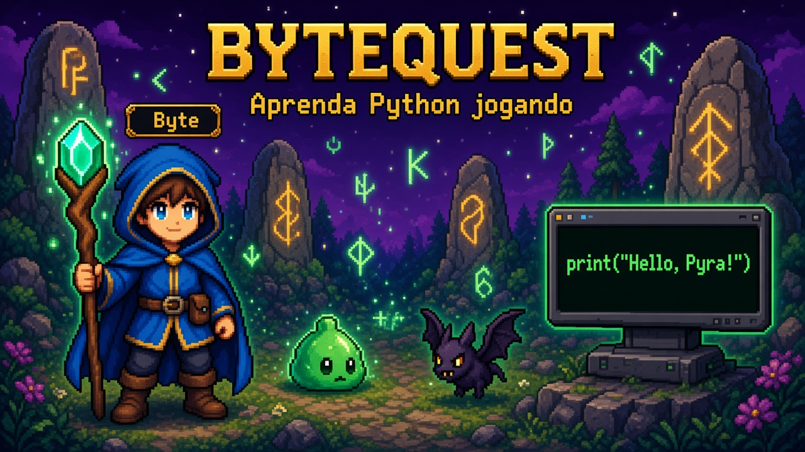

# Portfólio — Lucas Mesquita

> Projetos de desenvolvimento, automação, jogos educacionais e entregas web para clientes.
> GitHub: [github.com/lcsmqt](https://github.com/lcsmqt)

---

## Sobre

Estudante de Análise e Desenvolvimento de Sistemas em transição para TI. Este repositório centraliza a vitrine visual dos projetos — **sem código-fonte de clientes** nem dados sensíveis. Cada seção contém capturas de tela, identidade visual e descrição técnica genérica.

---

## Destaques

### BYTEQUEST — RPG educacional de Python

Jogo 8-bit no navegador que ensina Python do zero através de aventura, runas de código e batalhas contra bugs.

| | |
|---|---|
| **Repositório** | [bytequest](https://github.com/lcsmqt/bytequest) |
| **Stack** | TypeScript, Phaser 4, Pyodide, Vite |
| **Status** | 5 mundos jogáveis, 20 desafios verificados |

---

## Projetos técnicos (código aberto)

| Projeto | Área | Stack | Repositório |
|---|---|---|---|
| Helpdesk Ticket API | Backend / API | FastAPI, PostgreSQL, JWT, RBAC | [helpdesk-ticket-api](https://github.com/lcsmqt/helpdesk-ticket-api) |
| IT Operations SQL Lab | Banco de Dados | PostgreSQL, views, triggers, CTEs | [it-operations-sql-lab](https://github.com/lcsmqt/it-operations-sql-lab) |
| Network Diagnostic Toolkit | Redes | Python, sockets, DNS, CIDR | [network-diagnostic-toolkit](https://github.com/lcsmqt/network-diagnostic-toolkit) |
| Linux Health Toolkit | Linux / Automação | Python, psutil, relatórios | [Linux-Health-Toolkit](https://github.com/lcsmqt/Linux-Health-Toolkit) |
| Integrity Guard | Cibersegurança | Python, SHA-256, SQLite | [Integrity-guard](https://github.com/lcsmqt/Integrity-guard) |

---

## Projetos web e marcas (vitrine visual)

> Apenas imagens e descrições. Código-fonte e dados de clientes **não** estão incluídos.

| Projeto | Tipo | Pasta |
|---|---|---|
| Caslu Soluções | Site comercial + Command Center | [client-projects/caslu-solucoes](client-projects/caslu-solucoes/) |
| FiscoVira | Plataforma tax-tech | [client-projects/fiscovira](client-projects/fiscovira/) |
| Intersessões | Ecossistema digital de livro | [client-projects/intersessoes](client-projects/intersessoes/) |
| JCM & Rio Seguros | Plataforma de corretora | [client-projects/jcmrio](client-projects/jcmrio/) |
| Snap Lab Academy | Landing + chatbot + funil | [client-projects/snap-lab](client-projects/snap-lab/) |
| SorrisoLocal | Lead-gen para clínicas | [client-projects/sorrisolocal](client-projects/sorrisolocal/) |
| Zanza Bijus | E-commerce de semijoias | [client-projects/zanza-bijus](client-projects/zanza-bijus/) |

---

## Tecnologias

`Python` · `TypeScript` · `FastAPI` · `Next.js` · `Astro` · `PostgreSQL` · `Phaser` · `Pyodide` · `Docker` · `Linux` · `Git`

---

## Contato

- LinkedIn: [lucas-mesquita](https://www.linkedin.com/in/lucas-mesquita-18711936a)
- E-mail: lcssmqt@gmail.com
- Instagram: [@lmsqt_](https://www.instagram.com/lmsqt_)
