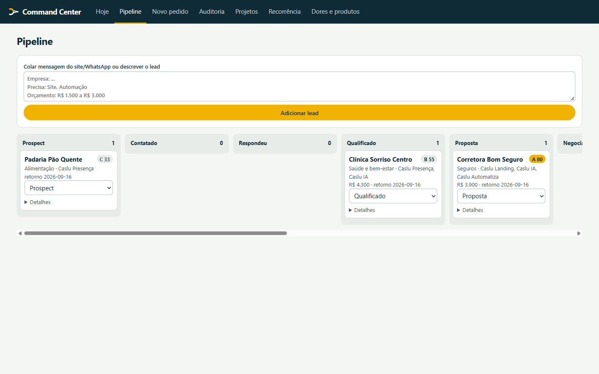

# Caslu Soluções

**Tipo:** Site comercial + painel operacional (Command Center)  
**Stack:** Astro, Node.js, HTML/CSS  
**Papel:** Agência digital — site institucional, intake de clientes, pipeline de vendas e auditoria digital

## Escopo

- Site comercial responsivo em português (preparado para internacionalização)
- Command Center local: gestão de leads, pipeline, métricas e follow-ups
- Sistema de marca completo (logo, avatar, OG image)
- Automação de intake via CLI e painel web

## Galeria

| Desktop | Mobile | Painel |
|---|---|---|
|  |  |  |

> Código-fonte, dados de clientes e configurações internas não estão incluídos neste repositório.
