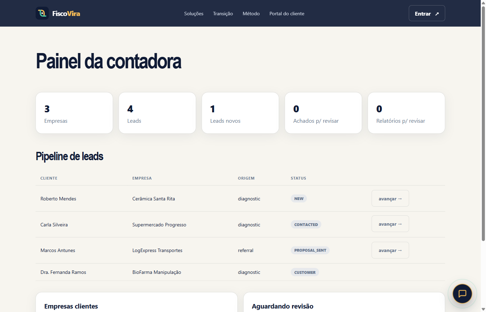
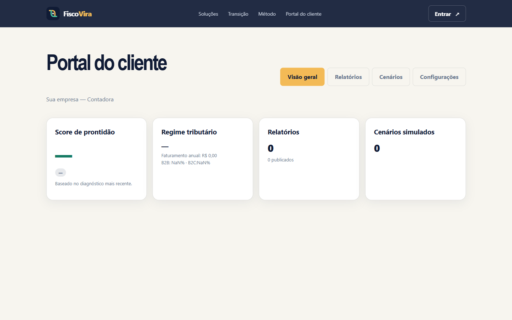

# FiscoVira

**Tipo:** Plataforma tax-tech + consultoria contábil  
**Stack:** Next.js, TypeScript, Tailwind CSS  
**Papel:** Diagnóstico tributário, dashboard gerencial, assistente IA e portal do cliente

## Escopo

- Landing page com funil de diagnóstico tributário
- Dashboard gerencial para acompanhamento de reforma (IBS/CBS)
- Assistente IA com revisão humana (human-in-the-loop)
- Portal do cliente com acesso seguro
- Design system e identidade visual completa

## Galeria

| Landing | Dashboard | IA Assistente | Portal |
|---|---|---|---|
|  |  |  |  |

> Código-fonte, propostas comerciais e dados de clientes não estão incluídos.
