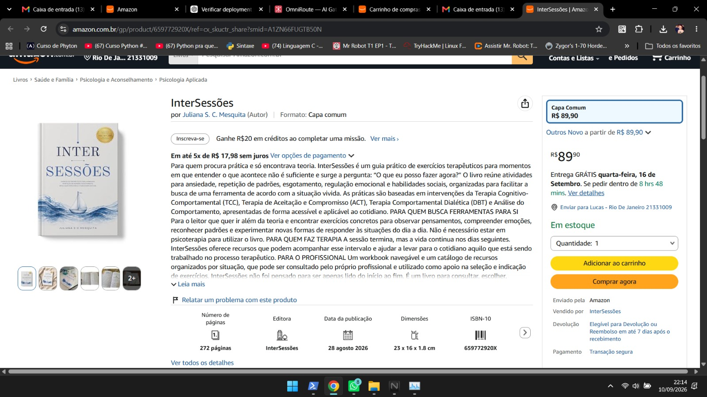

# Intersessões

**Tipo:** Ecossistema digital de livro / marca autoral  
**Stack:** Astro, SEO, campanhas digitais  
**Papel:** Site do autor, estratégia de conteúdo, otimização Amazon e press kit

## Escopo

- Site institucional do autor com identidade visual
- Estratégia de posicionamento e voz da marca
- Otimização para Amazon e SEO
- Campanhas de lançamento e press kit
- Conteúdo voltado a leitores entre sessões de terapia

## Galeria

| Logo | Capa do livro | Foto autora |
|---|---|---|
|  |  |  |

> Conteúdo do livro, PDFs originais e material protegido por direitos autorais não estão incluídos.
