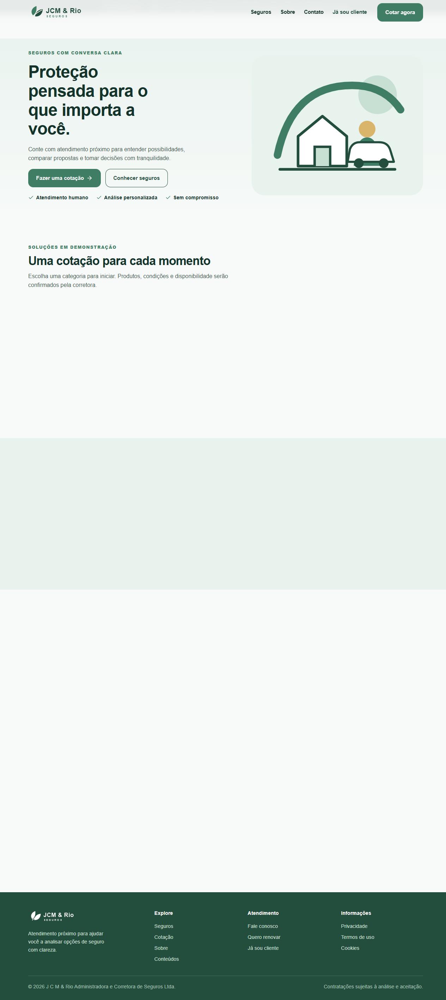

# JCM & Rio Seguros

**Tipo:** Plataforma de corretora de seguros  
**Stack:** Next.js, Prisma, Auth.js  
**Papel:** Site institucional, cotação online, portal do cliente e painel admin

## Escopo

- Site institucional com catálogo de produtos de seguros
- Fluxo de cotação online com protocolo de acompanhamento
- Portal do cliente para apólices e documentos
- Painel administrativo com gestão de leads (LGPD)
- Blog institucional

## Galeria

| Logo | Hero |
|---|---|
|  |  |

> Código-fonte, especificações internas e dados de clientes não estão incluídos.
