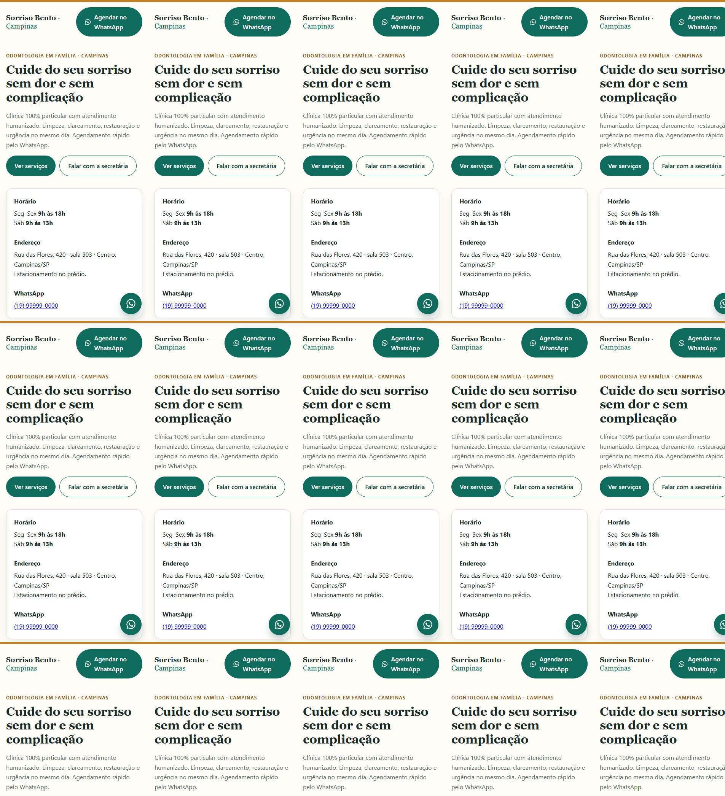
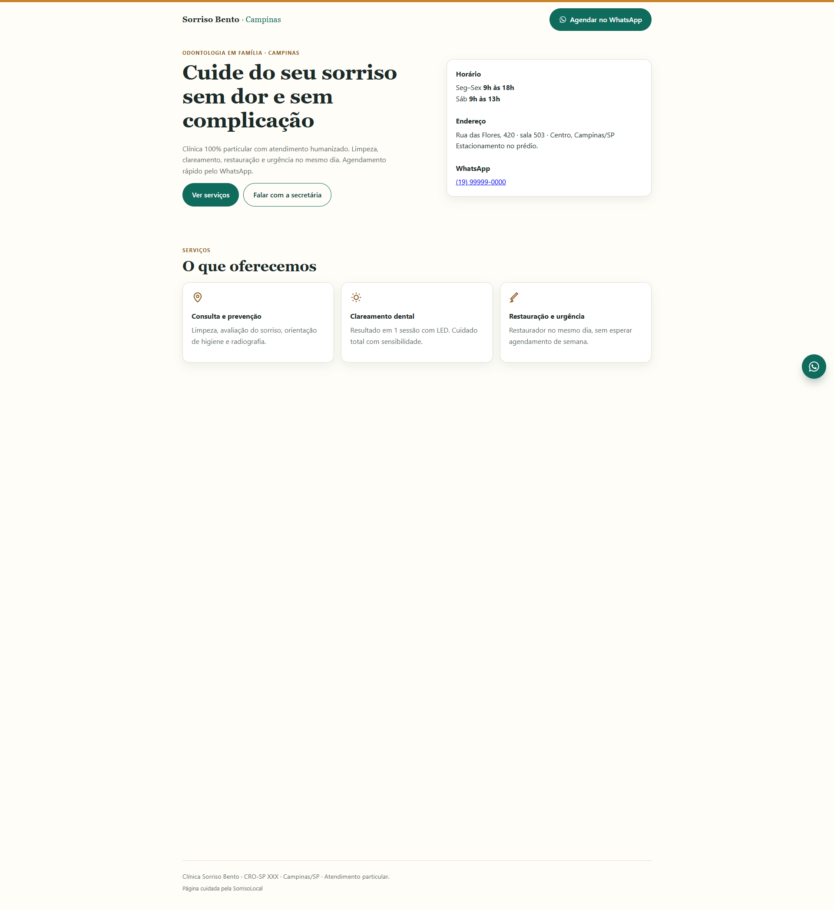

# SorrisoLocal

**Tipo:** Pacote de captação de pacientes para clínicas odontológicas  
**Stack:** Flask (painel admin), HTML/CSS (landing)  
**Papel:** Landing de agendamento, Google Business Profile e painel local

## Escopo

- Landing page mobile-first com agendamento e WhatsApp one-tap
- Configuração de Google Business Profile
- Painel administrativo local para gestão de leads
- Kit de entrega para clínicas de 1–3 cadeiras
- Mercado piloto: região de Campinas/SP

## Galeria

| Desktop | Mobile |
|---|---|
|  |  |

> Banco de dados de leads, propostas comerciais e código-fonte não estão incluídos.
