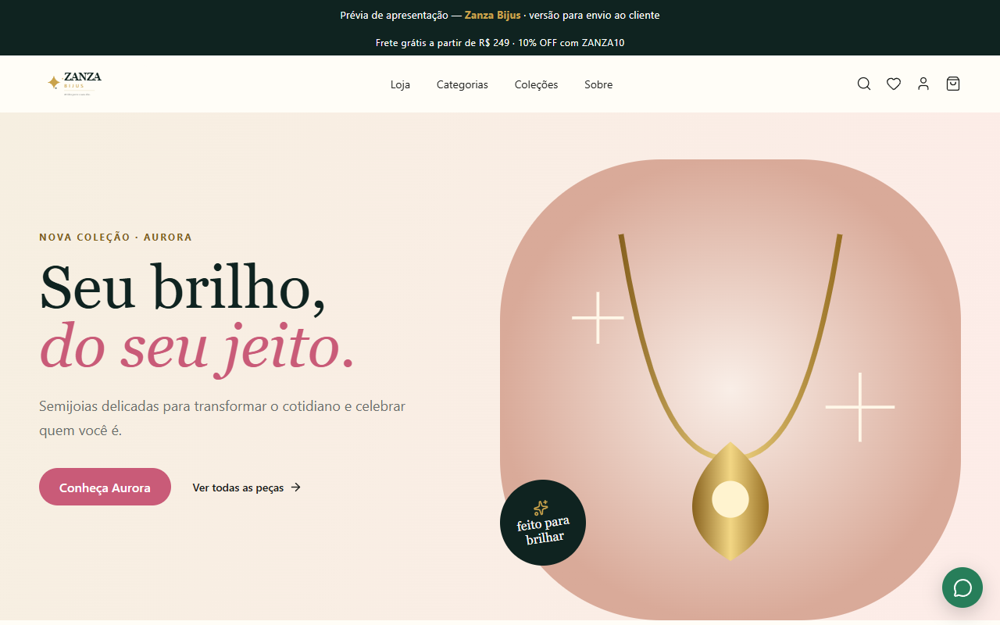

# Zanza Bijus

**Tipo:** E-commerce de semijoias  
**Stack:** Next.js 16, Prisma, Auth.js, PWA  
**Papel:** Loja virtual completa com painel administrativo

## Escopo

- Identidade visual e catálogo de produtos com filtros
- Carrinho, checkout e cupons de desconto
- Painel admin: produtos, pedidos, clientes e banners
- Integração WhatsApp para atendimento
- PWA-ready para experiência mobile

## Galeria

| Logo | Hero | Produtos |
|---|---|---|
|  |  |  ·  |

> Código-fonte, credenciais de demo e dados de clientes não estão incluídos.
